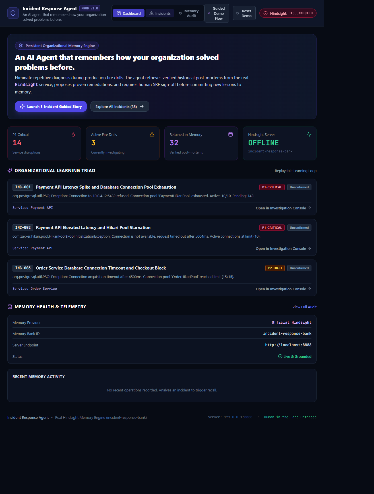
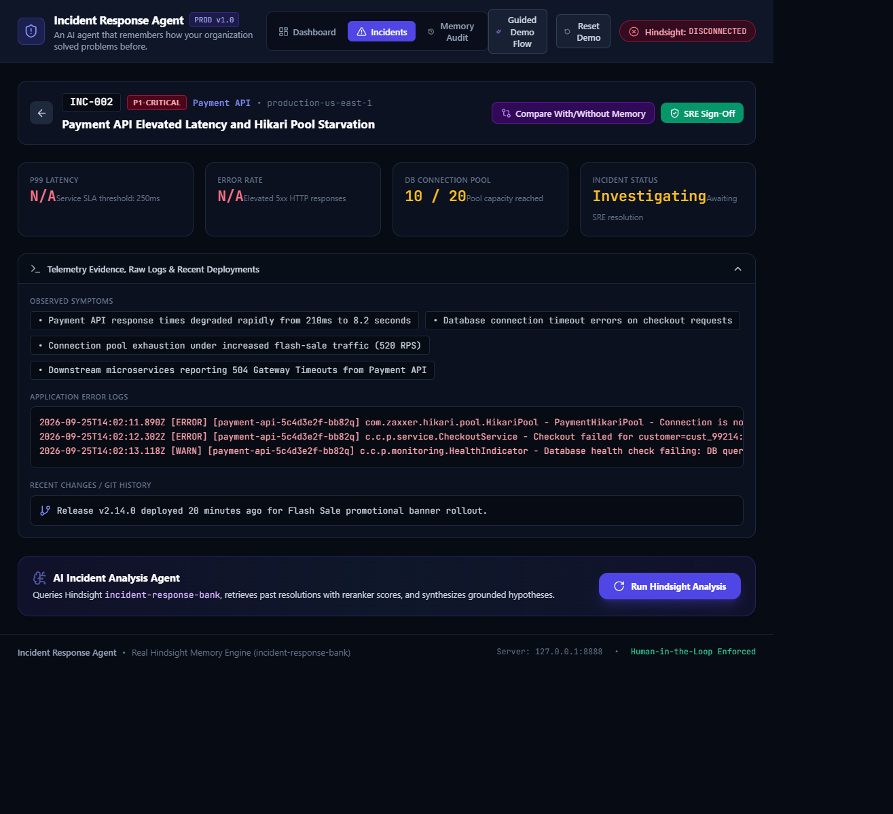

# 🛡️ Incident Response Agent

> **Tagline:** *"An AI agent that remembers how your organization solved problems before."*

[](https://fastapi.tiangolo.com)
[](https://react.dev)
[](https://github.com/google/hindsight)
[](https://www.typescriptlang.org)
[](https://tailwindcss.com)

## 🖥️ Product Screenshots

| Operations Dashboard | Incident Investigation Console |
|:---:|:---:|
|  |  |

*Screenshots use the seeded incident dataset. Hindsight connection status reflects the services running in the local demo environment.*

---

## 📌 Executive Summary

Modern engineering teams suffer from repeated production outages because post-mortem lessons are scattered across Jira tickets, Google Docs, and Slack channels. Standard LLMs suffer from amnesia across incidents and repeatedly guess root causes from scratch.

The **Incident Response Agent** implements a continuous, closed-loop organizational learning engine:
1. **Persistent Institutional Memory:** Uses the real **Google DeepMind Hindsight** engine (`incident-response-bank`) to recall confirmed historical precedents.
2. **Provenance-Aware Diagnosis:** Synthesizes live telemetry and distinguishes `[CURRENT EVIDENCE]` from `[HISTORICAL PRECEDENT]` and `[RUNBOOK]`.
3. **Human-in-the-Loop Governance:** AI proposals are safety-gated. Only human SRE approval commits verified post-mortems back into Hindsight via `aretain()`.
4. **Cross-Service Knowledge Propagation:** Best practices discovered in one microservice automatically transfer to related services.

---

## 🏗️ System Architecture

```mermaid
flowchart TD
    subgraph UI ["SRE Incident Console (React + Vite)"]
        Dashboard["Dashboard & Vitals"]
        Console["Investigation Console"]
        Trace["6-Step Diagnostic Stepper"]
        Modal["Human Sign-Off Gate"]
        Comp["With vs Without Memory"]
    end

    subgraph Backend ["FastAPI Application (Port 8000)"]
        Router["API Gateway /api/*"]
        AgentSvc["Diagnostic Agent Service"]
        HindsightSvc["Hindsight Async Client"]
        DB[(SQLite incidents.db)]
    end

    subgraph MemoryEngine ["Hindsight API Server (Port 8888)"]
        Bank["Bank: incident-response-bank"]
        Embed["SentenceTransformers (bge-small-en)"]
        Rerank["Cross-Encoder (ms-marco-MiniLM)"]
        Pg0[(Embedded pg0 pgvector)]
    end

    UI -->|HTTP / REST| Router
    Router --> AgentSvc
    Router --> DB
    AgentSvc -->|arecall() / aretain()| HindsightSvc
    HindsightSvc -->|HTTP REST| MemoryEngine
    MemoryEngine --> Bank
    Bank --> Embed
    Bank --> Rerank
```

---

## 🚀 Deployment Options

### Option 1: One-Click Production Runner (Recommended)

#### One-time setup (Windows)
From the repository root, create the backend environment and install its dependencies, including the separate Hindsight API server package:

```powershell
py -3.11 -m venv backend\.venv
backend\.venv\Scripts\python.exe -m pip install -r backend\requirements.txt
cd frontend
npm ci
cd ..
```

Both production runners install `hindsight-api==0.10.1` if the server executable is missing, then verify that the server becomes healthy before starting the app.

#### Windows (PowerShell):
```powershell
.\start_production.ps1
```

#### One-time setup (Linux / macOS)
```bash
python3 -m venv backend/.venv
backend/.venv/bin/python -m pip install -r backend/requirements.txt
cd frontend && npm ci && cd ..
```

#### Linux / macOS (Bash):
```bash
chmod +x ./start_production.sh
./start_production.sh
```

This single command:
1. Starts the official **Hindsight API server** on port `8888`.
2. Verifies and builds the React frontend (`npm run build`).
3. Initializes the SQLite database and seeds 35 enterprise incidents.
4. Launches the production FastAPI server on **`http://127.0.0.1:8000`**.
5. Automatically opens your browser.

---

### Option 2: Docker Container Deployment

The multi-stage `Dockerfile` packages the compiled React SPA, FastAPI backend, and Hindsight API server:

```bash
# 1. Build Docker image
docker build -t incident-response-agent .

# 2. Run container
docker run -d -p 8000:8000 -p 8888:8888 --name incident-agent incident-response-agent

# 3. Access in browser
http://localhost:8000
```

---

### Option 3: Docker Compose (Microservices Architecture)

Run Hindsight and the Application as decoupled, orchestrated services:

```bash
docker compose up -d
```

- **Application & Dashboard:** `http://localhost:8000`
- **Hindsight Server:** `http://localhost:8888`
- **Swagger Documentation:** `http://localhost:8000/docs`

---

### Option 4: Cloud Deployment (Render / GCP Cloud Run / AWS)

#### Render.com
The repository includes a [`render.yaml`](file:///C:/Users/ADMIN/.gemini/antigravity/scratch/incident-response-agent/render.yaml) blueprint:
1. Connect your Git repository to Render.
2. Select **New Blueprint Instance**.
3. Render automatically provisions the Docker Web Service on port `8000`.

#### Google Cloud Run
```bash
gcloud builds submit --tag gcr.io/[PROJECT_ID]/incident-response-agent
gcloud run deploy incident-response-agent \
  --image gcr.io/[PROJECT_ID]/incident-response-agent \
  --platform managed \
  --port 8000 \
  --allow-unauthenticated
```

---

## 🎬 3-Minute Live Demo Flow

To replay the guided demonstration:
1. Open **`http://127.0.0.1:8000`**.
2. Observe the top navigation status: `Hindsight: CONNECTED`.
3. **Step 1 (INC-001 — Payment API Cold Start):** Run analysis $\to$ 0 precedents found $\to$ SRE approves resolution $\to$ Retains verified memory into Hindsight.
4. **Step 2 (INC-002 — Payment API Recurrence):** Run analysis $\to$ Hindsight recalls INC-001 with genuine similarity/reranker scores $\to$ Hypothesis shifts to 94% confidence under `[HISTORICAL PRECEDENT]`.
5. **Head-to-Head Comparison:** Click **Compare With/Without Memory** on INC-002 to view live side-by-side responses from `/analyze-isolated` vs `/analyze`.
6. **Step 3 (INC-003 — Order Service Cross-Service):** Run analysis $\to$ Recalls connection pool lessons from Payment API $\to$ Demonstrates cross-service knowledge propagation.
7. **Audit & Architecture:** Open **Memory Audit** to view the immutable event feed, then click **Learning Loop Architecture** to view the full 10-step conceptual loop.

*(Click the **Reset Demo** button in the navbar at any time to replay from a clean baseline).*

---

## ⚙️ Environment Variables

| Variable | Default | Description |
| :--- | :--- | :--- |
| `HINDSIGHT_BASE_URL` | `http://127.0.0.1:8888` | Base URL of official Hindsight server. |
| `HINDSIGHT_BANK_ID` | `incident-response-bank` | Target Hindsight memory bank identifier. |
| `HINDSIGHT_API_KEY` | *(None)* | Optional API key for hosted Hindsight deployments. |
| `HINDSIGHT_API_LLM_PROVIDER` | `mock` | LLM synthesis provider for local Hindsight instances. |
| `PORT` | `8000` | HTTP port for the unified application. |
| `ENVIRONMENT` | `production` | Environment mode (`development` / `production`). |

---

## 🧪 Automated Testing

Run the full test suite (unit, integration, and walkthrough regression tests):

```bash
cd backend
.\.venv\Scripts\python.exe -m pytest -v
```

**Verification Status:** 36 passed in ~60s (100% test pass rate).
